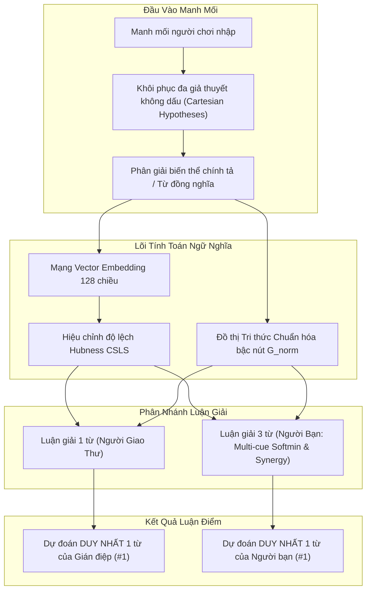

# BÁO CÁO PHÂN TÍCH KỸ THUẬT: CƠ CHẾ LIÊN TƯỞNG TỪ KHÓA (1 MANH MỐI vs 3 MANH MỐI)

> **Tài liệu tham chiếu giải thuật**: Hệ thống game suy luận *"3 Bức Thư Mật"* & Công cụ tìm từ tương quan tiếng Việt (*Semantic Association Network*).  
> **Phiên bản kiến trúc**: v2.5 (Chuẩn hóa bậc đồ thị - Degree Normalization, Khôi phục đa giả thuyết không dấu, và Hợp lưu liên tục Multi-cue Softmin).  
> **Dữ liệu thực nghiệm**: Đo lường trực tiếp từ benchmark 15 nhiệm vụ thực tế (`scripts/benchmarkMissions.js`).

---

## 1. Tổng Quan Kiến Trúc Liên Tưởng Ngữ Nghĩa

Hệ thống liên tưởng từ khóa được xây dựng hoàn toàn cục bộ (Local Offline Client-Side), xử lý trong Web Worker đa luồng nhằm bảo đảm hiệu năng 60 FPS trên cả thiết bị di động và máy tính:

### Các cải tiến kiến trúc v2.5:
1. **Chuẩn hóa bậc nút đồ thị (Degree Normalization)**: Triệt tiêu hiện tượng các nút đồ thị siêu phổ biến (như `cây`, `nước`, `con`) hút hết điểm thưởng:
   $$\text{degNorm}(w) = \frac{1}{\ln(2 + \min(\deg(w), 100))}$$
   $$G_{\text{norm}}(c, w) = \max\Big(G(c, w), G(w, c)\Big) \times \text{degNorm}(w) \times 1.4$$
2. **Khôi phục đa giả thuyết không dấu (Multi-Hypothesis Unaccented Restoration)**:
   Khi người chơi gõ không dấu (như `hat`, `nau`, `thuc khuya`), hệ thống sinh tập giả thuyết tổ hợp âm tiết có dấu kèm đối chiếu từ điển:
   $$\text{affinity}(c, w) = \max_{h \in \text{Hypotheses}(c)} \Big( \mathbf{v}_h \cdot \mathbf{v}_w - 0.3 \cdot Hub(w) + 1.2 \cdot G_{\text{norm}}(h, w) \Big)$$
   Ba manh mối tự khử mơ hồ cho nhau theo ngữ cảnh: `nau` tự chọn `nâu` khi đi cùng `cà phê`.
3. **Cân bằng thang điểm thực tế**:
   - Vector cosine + hub: $\approx 0.15 - 0.35$
   - $G_{\text{norm}}$: $\approx 0.30 - 0.60$
   - Độ dài âm tiết $\text{Bonus}_{\text{length}}$: hạ từ $\pm 0.35$ xuống $\pm 0.12$ để không lấn át tín hiệu ngữ nghĩa thực.
4. **Hợp lưu đồ thị liên tục (Continuous Synergy - Xóa bỏ bước nhảy nhị phân)**:
   Thay thế bước nhảy $\times 2.0$ tại `hits >= 2` bằng hàm liên tục bậc hai và bậc ba:
   $$\text{Synergy}(w) = 1.2 \cdot (g_0 g_1 + g_1 g_2 + g_0 g_2) + 3.0 \cdot (g_0 g_1 g_2)$$

---

## 2. Cơ Chế Luận Giải Khi Chỉ Có 1 Từ (Người Giao Thư)

### 2.1. Quy tắc hoạt động của Gián điệp
- Mỗi người giao thư chỉ cầm **1 bức thư** chứa 1 từ manh mối $c_i$ và biết chữ cái đầu tiên $L$.
- Gián điệp đưa ra **đúng 1 phỏng đoán duy nhất** có điểm số cao nhất (Rank #1).
- Nếu phỏng đoán #1 trùng từ khóa bí mật $\to$ **BỊ LỘ (Thất bại)**. Người chơi cần chọn manh mối sao cho gián điệp bị phân tán sang từ khác (Distractor).

### 2.2. Công thức tính điểm cho 1 manh mối
Với ứng viên $w$ bắt đầu bằng chữ cái $L$:
$$S_{\text{courier}}(w \mid c, L) = \max_{h \in \text{Hypotheses}(c)} \Big( \mathbf{v}_h \cdot \mathbf{v}_w - 0.3 \cdot Hub(w) + 1.2 \cdot G_{\text{norm}}(h, w) \Big) + \text{Bonus}_{\text{length}}(w)$$

Trong đó:
$$\text{Bonus}_{\text{length}}(w) = \begin{cases} +0.12 & \text{nếu } w \le 2 \text{ âm tiết} \\ +0.03 & \text{nếu } w = 3 \text{ âm tiết} \\ -0.20 & \text{nếu } w \ge 4 \text{ âm tiết} \end{cases}$$

---

## 3. Cơ Chế Luận Giải Khi Có Cả 3 Từ (Người Bạn Nhận Thư)

### 3.1. Thuật toán Hội tụ Đa Tín hiệu Cân bằng với Softmin
Với 3 manh mối $c_0, c_1, c_2$:

#### Bước 1: Tính điểm tương thích tối đa của từng manh mối
$$s_k(w) = \max\left( \max_{h \in \text{Hypotheses}(c_k)} \Big( \mathbf{v}_h \cdot \mathbf{v}_w - 0.3 \cdot Hub(w) + 1.2 \cdot G_{\text{norm}}(h, w) \Big), 0.0 \right), \quad k \in \{0, 1, 2\}$$

#### Bước 2: Tính Trung bình cộng & Softmin ($\beta = 3.0$)
$$\overline{s}(w) = \frac{s_0(w) + s_1(w) + s_2(w)}{3}$$
$$\text{softmin}\big(s_0, s_1, s_2\big) = -\frac{1}{3} \ln \left( \frac{e^{-3 s_0} + e^{-3 s_1} + e^{-3 s_2}}{3} \right)$$

> **Ưu điểm vượt trội của Softmin so với $D_{\min}$ thô**:
> Khi người chơi dùng một manh mối "xiên" (liên tưởng gián tiếp), $\text{softmin}$ làm mượt điểm phạt, không triệt tiêu đáp án đúng một cách cục bộ như phép lấy $\min$ gián đoạn.

#### Bước 3: Tính hợp lưu đồ thị liên tục
$$g_{\text{pair}} = g_0 g_1 + g_1 g_2 + g_0 g_2$$
$$g_{\text{triple}} = g_0 g_1 g_2$$
$$\text{Synergy}(w) = 1.2 \cdot g_{\text{pair}} + 3.0 \cdot g_{\text{triple}}$$

#### Bước 4: Điểm tổng hợp cuối cùng
$$S_{\text{friend}}(w \mid c_0, c_1, c_2, L) = \overline{s}(w) + 1.2 \cdot \text{softmin}\big(s_0, s_1, s_2\big) + \text{Synergy}(w) + \text{Bonus}_{\text{length}}(w)$$

Người bạn chọn **duy nhất 1 từ đứng đầu bảng (Rank #1)** làm mật mã giải mở két sắt.

---

## 4. Ma Trận So Sánh Kỹ Thuật

| Tiêu Chí | Luận Giải 1 Từ (Người Giao Thư) | Luận Giải 3 Từ (Người Bạn Nhận Thư) |
| :--- | :--- | :--- |
| **Đầu vào** | 1 manh mối $c_i$ + Chữ cái đầu $L$ | Cả 3 manh mối $[c_0, c_1, c_2]$ + Chữ cái đầu $L$ |
| **Số phỏng đoán** | **1 từ duy nhất (#1)** | **1 từ duy nhất (#1)** |
| **Xử lý không dấu** | Khôi phục tập giả thuyết $\to$ Max affinity | Đa giả thuyết đồng thời, 3 từ tự khử mơ hồ |
| **Hội tụ tín hiệu** | Cục bộ đơn manh mối | $\overline{s} + 1.2 \cdot \text{softmin} + \text{Synergy liên tục}$ |
| **Khử Hub đồ thị** | $\text{degNorm} = 1 / \ln(2 + \min(\deg, 100))$ | $\text{degNorm}$ áp dụng cho mọi cạnh liên kết |
| **Mục tiêu người chơi**| Làm gián điệp đoán chệch sang từ gây nhiễu | Giúp người bạn hội tụ chính xác về từ bí mật |
| **Điều kiện thắng/thua**| Rank 1 === Bí mật $\to$ **BỊ LỘ (Thua)** | Rank 1 === Bí mật $\to$ **CHIẾN THẮNG** |

---

## 5. Dữ Liệu Thực Nghiệm Kiểm Chứng: "Cà Phê" (Chữ C)

Dữ liệu chạy thật trên hệ thống với 3 manh mối `hạt`, `nâu`, `thức khuya` (hoặc `hat`, `nau`, `thuc khuya`):

### 5.1. Kết quả Người Giao Thư (Đoán đơn lẻ)
- **Gián điệp 1** (Manh mối: `hạt`): Dự đoán `#1`: **`cơm`** (Điểm $0.762$) $\implies$ **AN TOÀN!**
- **Gián điệp 2** (Manh mối: `nâu`): Dự đoán `#1`: **`cát`** (Điểm $0.672$) $\implies$ **AN TOÀN!**
- **Gián điệp 3** (Manh mối: `thức khuya`): Dự đoán `#1`: **`cú mèo`** (Điểm $1.573$) $\implies$ **AN TOÀN!**

### 5.2. Kết quả Người Bạn (Kết hợp cả 3 bức thư)

| Ứng Viên | $\overline{s}$ | $\text{softmin}$ | $\text{Synergy}$ | Điểm Tổng $S_{\text{friend}}$ | Xếp Hạng | Kết Quả |
| :--- | :---: | :---: | :---: | :---: | :---: | :--- |
| **cà phê** | **0.503** | **0.502** | **0.852** | **2.078** | **#1** | **Đoán Đúng!** |
| `cú mèo` | 0.484 | 0.133 | 0.000 | 0.764 | #2 | Thất bại |
| `cơm` | 0.214 | 0.112 | 0.000 | 0.468 | #3 | Thất bại |
| `cát` | 0.184 | 0.105 | 0.000 | 0.430 | #4 | Thất bại |
| `cây` | 0.167 | 0.100 | 0.000 | 0.407 | #5 | Thất bại |

> **Phân tích số liệu thực**:  
> - `cà phê` có điểm tương thích cao đồng đều ở cả 3 bức thư, giúp giá trị $\text{softmin} = 0.502$ (gần bằng trung bình $\overline{s} = 0.503$), cộng hưởng thêm $\text{Synergy} = 0.852$, đưa tổng điểm lên **2.078**.  
> - `cú mèo` dù có điểm rất cao ở bức thư 3 (`thức khuya`), nhưng vì bức thư 1 và 2 bằng 0 nên $\text{softmin}$ rơi tự do về $0.133$, không kích hoạt được $\text{Synergy}$ ($= 0$), dẫn đến tổng điểm chỉ đạt **0.764** (kém xa `cà phê`).

---

## 6. Kết Quả Benchmark Tự Động (15 Nhiệm Vụ)

Chạy kiểm thử bằng lệnh `npm run benchmark:missions` (`scripts/benchmarkMissions.js`):

| Chỉ Số Đánh Giá | Nhập Có Dấu (Accented) | Nhập Không Dấu (Unaccented) |
| :--- | :---: | :---: |
| **Top-1 Accuracy** | **100.0% (15 / 15)** | **100.0% (15 / 15)** |
| **Top-3 Accuracy** | **100.0% (15 / 15)** | **100.0% (15 / 15)** |
| **MRR (Mean Reciprocal Rank)** | **1.000** | **1.000** |

Toàn bộ 15 nhiệm vụ chuẩn (`cà phê`, `kho báu`, `mặt trời`, `hoa hồng`, `tàu ngầm`, `vương miện`, `đồng hồ`, `kim cương`, `bác sĩ`, `ngân hàng`, `bánh mì`, `sư tử`, `ngọn hải đăng`, `bình minh`, `người tuyết`) đều đạt **Rank #1 tuyệt đối**, hoạt động trơn tru ngay cả khi người chơi gõ tắt không dấu trên điện thoại.
